# Robust crop disease screening with explainable deep learning

Plant disease classifiers often report very high accuracy on PlantVillage, a dataset of clean leaf photos taken on plain backgrounds. Real field photos are blurred, noisy, dark or compressed. This project asks how much of that accuracy survives when image quality drops, whether training with corrupted images helps, and whether the models look at the diseased part of the leaf when they make a decision.

The work covers four parts:

1. A transfer-learning baseline (EfficientNetV2-S) with a leakage-aware data split.
2. A corruption benchmark: Gaussian noise, brightness reduction and Gaussian blur, each at three severity levels.
3. An architecture comparison (ResNet50, DenseNet121, EfficientNet-B0, EfficientNetV2-S) and a corruption-aware training ablation.
4. Explainability and reliability checks: Grad-CAM, reliability diagrams and the multiclass Brier score.

> Status: research code for a paper under review. Numerical results will be added to this README after publication. Figures from the notebooks are included below.

## Scope

This project is about disease screening, not early detection. PlantVillage has no verified disease-stage labels (early, moderate, severe), so the models are not evaluated on how early they can catch a disease.

## Dataset

| Item | Detail |
|---|---|
| Dataset | PlantVillage, colour images |
| Source | Hugging Face, [`mohanty/PlantVillage`](https://huggingface.co/datasets/mohanty/PlantVillage) |
| Size | about 54,300 images |
| Classes | 38 (14 crop species, diseased and healthy leaves) |
| Input size | 224 × 224 |

The dataset is not stored in this repository. Notebook 01 downloads it from Hugging Face. The Kaggle notebooks (02 to 04) read it from a Kaggle dataset copy of the same files and the same split.

### Avoiding leakage

PlantVillage contains several photos of the same physical leaf. If photos of one leaf land in both the training and validation sets, validation scores go up for the wrong reason. The pipeline:

- keeps the official train/test split,
- builds the validation set with a group-aware, stratified split, so all images of one leaf stay on the same side,
- checks that no leaf group appears in more than one split before training.

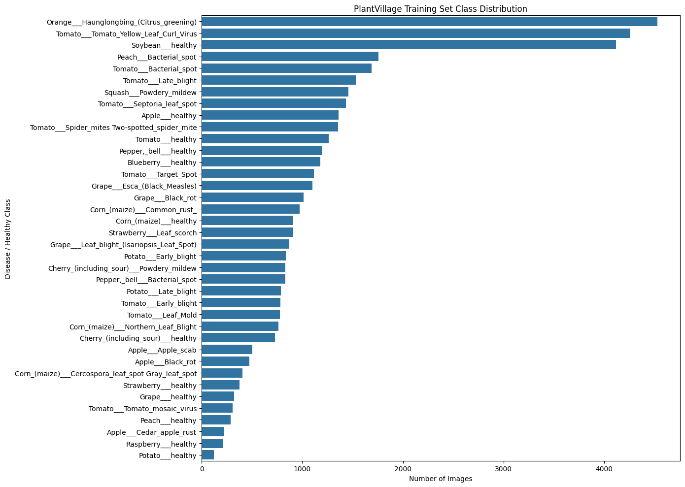

## Methods

### Baseline model

- EfficientNetV2-S pretrained on ImageNet, with a new 38-class head.
- Stage 1: train the classifier head only (AdamW, learning rate 1e-3, weight decay 1e-4).
- Stage 2: unfreeze feature blocks 5 to 7 and fine-tune (AdamW, learning rate 1e-4).
- Augmentation: horizontal flip, rotation up to 15 degrees, colour jitter.
- Model selection on validation macro-F1, with early stopping.

### Corruption benchmark

Each trained model is tested on the clean test set and on nine corrupted versions of it:

| Corruption | Mild | Moderate | Severe |
|---|---|---|---|
| Gaussian noise (std) | 0.03 | 0.07 | 0.12 |
| Brightness reduction (factor) | 0.80 | 0.60 | 0.40 |
| Gaussian blur (radius) | 1.0 | 2.0 | 3.0 |

### Architecture comparison

ResNet50, DenseNet121, EfficientNet-B0 and EfficientNetV2-S are trained on the same split and compared on clean accuracy, clean macro-F1, mean accuracy and macro-F1 across the nine corruptions, and parameter count.

### Corruption-aware training ablation (ResNet50)

| Variant | Corruption added during training |
|---|---|
| A0 | none (standard training) |
| A1 | Gaussian blur |
| A2 | Gaussian noise |
| A3 | brightness reduction |
| A4 | blur, noise and brightness |

A separate run (notebook 03) trains EfficientNetV2-S with a random corruption applied to half of the training images, drawn from Gaussian blur, motion blur, JPEG compression, brightness change and Gaussian noise.

### Class imbalance check

Notebook 04 retrains ResNet50 with a `WeightedRandomSampler` that oversamples rare classes, to see whether imbalance in PlantVillage affects per-class performance.

### Explainability and reliability

- Grad-CAM heatmaps on test images to check whether the model attends to lesions or to the background.
- Reliability diagram and multiclass Brier score to check whether the predicted confidence matches the observed accuracy.

## Figures

### Baseline training (EfficientNetV2-S)

| Loss and accuracy | Macro-F1 |
|---|---|
| 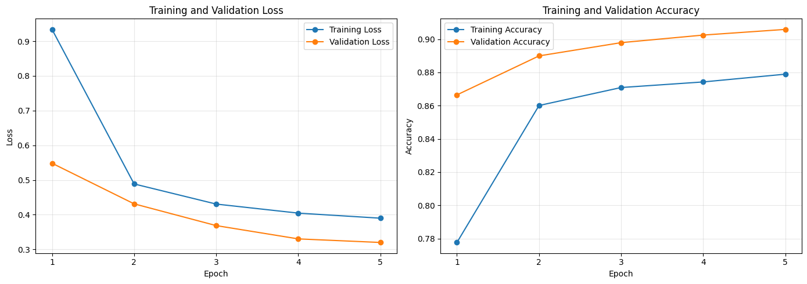 | 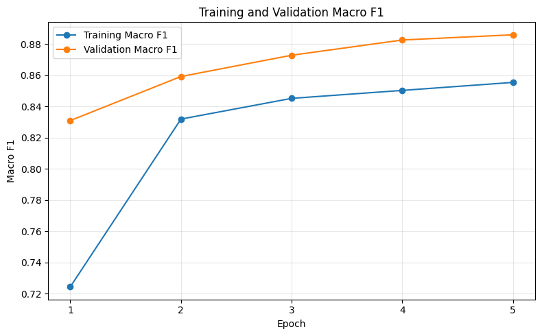 |

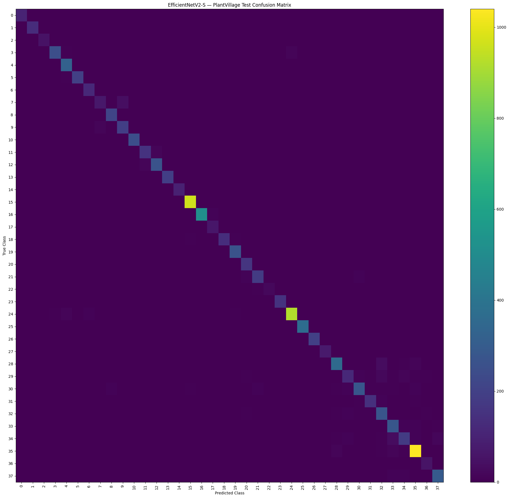

### Robustness under corruption

| Accuracy | Macro-F1 |
|---|---|
| 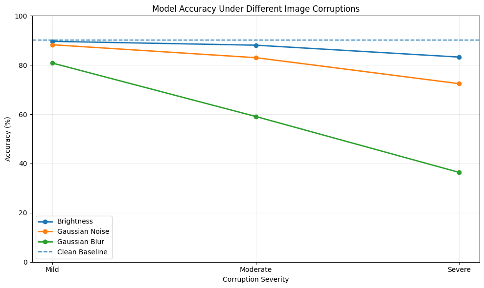 | 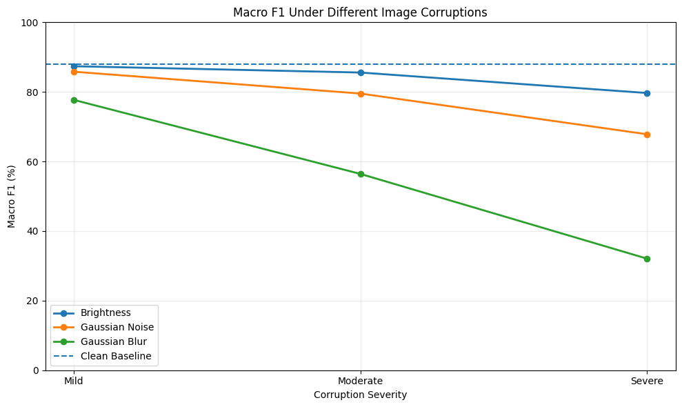 |

### Architecture comparison

| Clean accuracy | Mean accuracy under corruption |
|---|---|
| 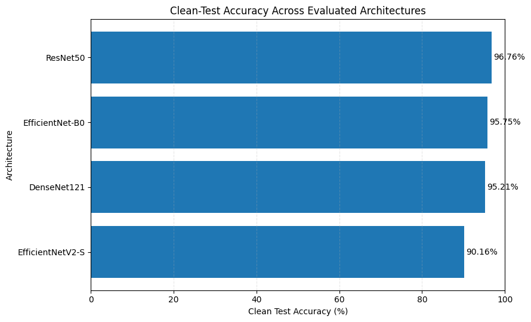 | 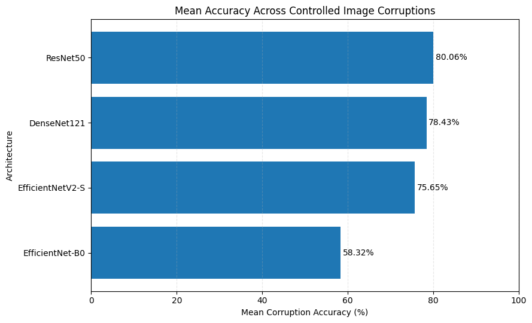 |

| Parameter count | Accuracy vs parameters |
|---|---|
| 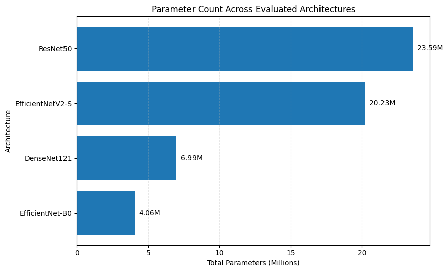 | 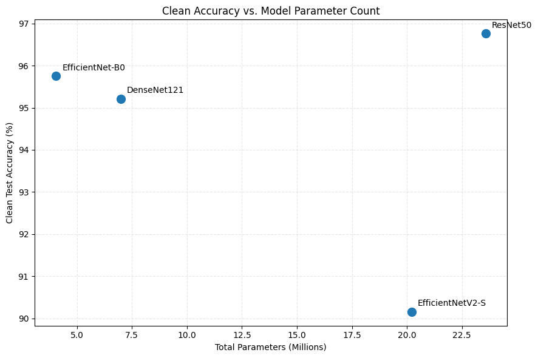 |

### Corruption-aware training ablation

| Clean vs corrupted accuracy | Accuracy per condition |
|---|---|
| 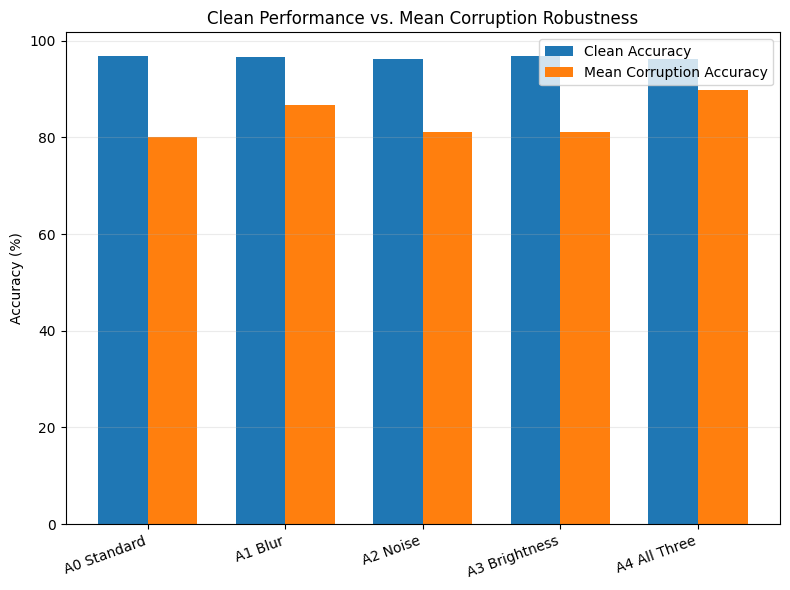 | 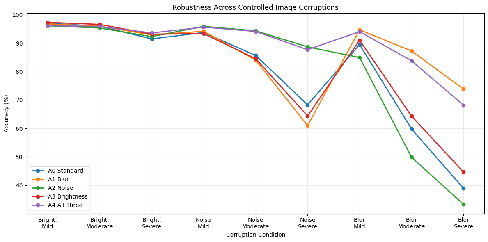 |

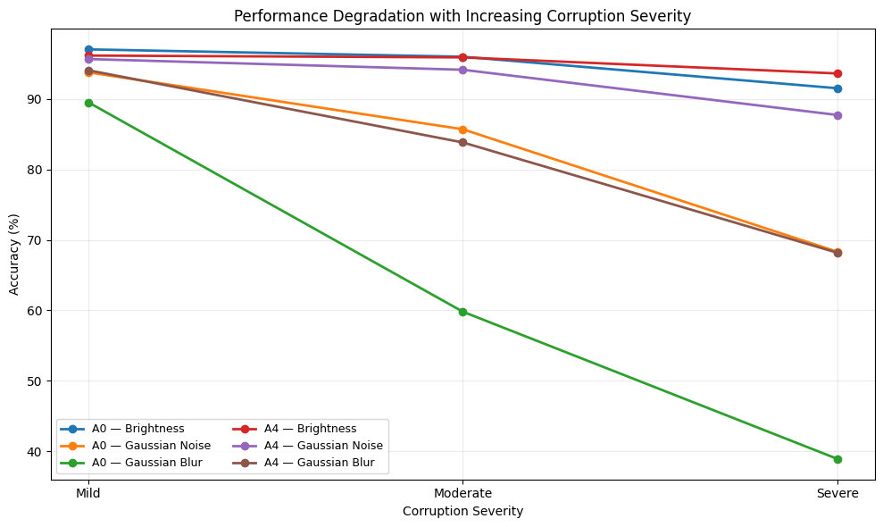

### Explainability and calibration

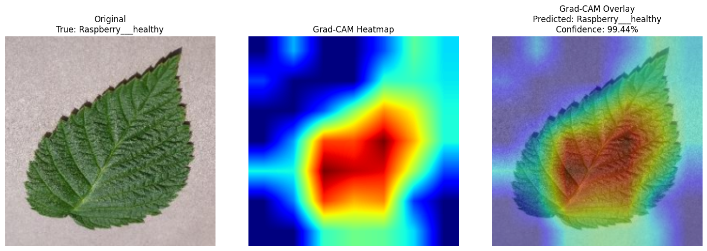

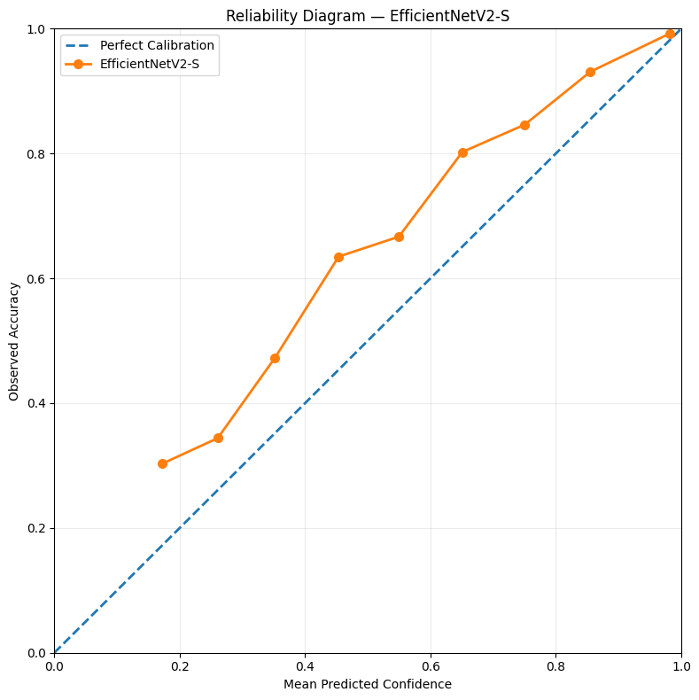

## Repository structure

```
robust-plant-disease-classification/
├── notebooks/
│   ├── 01_efficientnetv2s_baseline_robustness_xai.ipynb      data audit, split, baseline, corruption tests, Grad-CAM, calibration (Colab)
│   ├── 02_architecture_comparison_and_ablation.ipynb         four architectures and the A0 to A4 ablation (Kaggle)
│   ├── 03_corruption_aware_training_efficientnetv2s.ipynb    random-corruption training for EfficientNetV2-S (Kaggle)
│   └── 04_class_imbalance_oversampling_resnet50.ipynb        oversampling experiment (Kaggle)
├── figures/                                                  plots exported from the notebooks
├── requirements.txt
├── .gitignore
└── LICENSE
```

## How to run

1. Clone the repository and install the dependencies:

   ```bash
   git clone https://github.com/nadim7009/robust-plant-disease-classification.git
   cd robust-plant-disease-classification
   pip install -r requirements.txt
   ```

2. Run the notebooks in order. A GPU is strongly recommended.
   - Notebook 01 was written for Google Colab. It mounts Google Drive and downloads PlantVillage from Hugging Face. Change `PROJECT_DIR` if you run it elsewhere.
   - Notebooks 02 to 04 were written for Kaggle and read data from `/kaggle/input/...`. Update the dataset paths at the top of each notebook for your setup.

3. Model checkpoints (`.pth`) are written to the experiment folders during training. They are not included in the repository because of their size.

## Reproducibility notes

- Random seeds are fixed for Python, NumPy and PyTorch.
- The train/validation split and the class-to-index mapping are saved to disk and reused across notebooks, so all models see exactly the same data.
- Robustness evaluation is resumable, so a Colab or Kaggle disconnect does not restart the full benchmark.

## Citation

A citation will be added once the paper is published.

## License

Released under the MIT License. See [LICENSE](LICENSE).

## Contact

Nadim Mahmud, Daffodil International University
[LinkedIn](https://www.linkedin.com/in/nadim-mahmud-ml/) · [GitHub](https://github.com/nadim7009)
