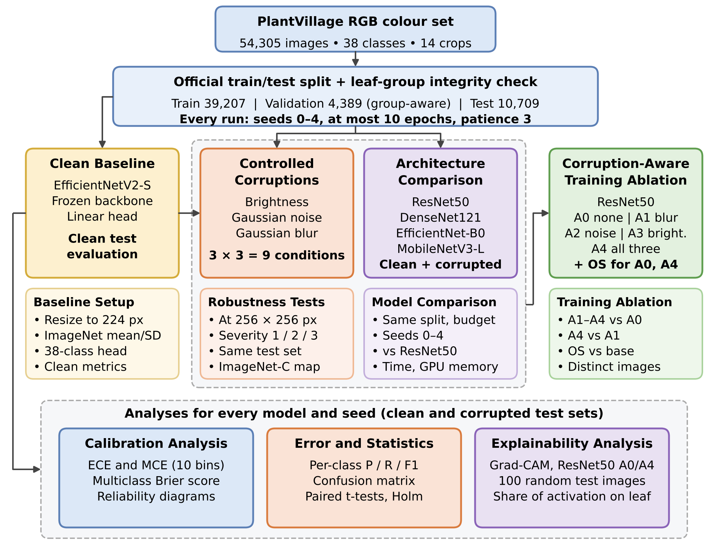

# Robust crop disease screening with explainable deep learning

Code and results for the paper "Beyond Clean Accuracy: Controlled Synthetic Corruption Evaluation and Corruption-Aware Training for Plant Disease Classification" (under review).

Plant disease classifiers often report very high accuracy on PlantVillage, a dataset of clean leaf photos taken on plain backgrounds. Field photos are blurred, noisy or dark. This project measures how much of that accuracy survives when image quality drops, whether training with corrupted images helps, and whether the models look at the leaf when they decide.

We train ImageNet-pretrained classifiers with frozen backbones on the 38-class PlantVillage colour images and test them on the clean test set and on nine corrupted copies of it: brightness reduction, Gaussian noise and Gaussian blur, each at three severities. On ResNet50 we also test corruption-aware training (A0 to A4) and class-balanced oversampling. Every configuration is trained with seeds 0 to 4 under the same budget, and differences are checked with paired t-tests and Holm correction. Calibration (ECE, MCE, Brier score) is measured for every model on clean and corrupted images, and Grad-CAM is checked against leaf masks.



## Main results

Mean ± SD over five seeds, accuracy in %. Mean corrupted is the average over the nine corrupted test sets; worst case is the lowest of the nine.

| Configuration | Clean | Mean corrupted | Worst case |
|---|---|---|---|
| ResNet50 (A0) | 96.58 ± 0.50 | 79.37 ± 1.34 | 38.83 ± 4.36 |
| DenseNet121 | 95.73 ± 0.36 | 77.98 ± 1.58 | 35.52 ± 5.57 |
| EfficientNet-B0 | 96.01 ± 0.36 | 57.91 ± 0.83 | 4.27 ± 0.53 |
| EfficientNetV2-S | 90.73 ± 0.57 | 76.74 ± 0.68 | 37.05 ± 3.32 |
| MobileNetV3-Large | 96.32 ± 0.51 | 72.93 ± 0.39 | 24.15 ± 0.94 |
| ResNet50 A1, blur | 96.74 ± 0.21 | 85.83 ± 0.36 | 63.59 ± 2.08 |
| ResNet50 A2, noise | 96.34 ± 0.15 | 81.01 ± 0.43 | 34.48 ± 2.10 |
| ResNet50 A3, brightness | 96.62 ± 0.07 | 80.53 ± 0.46 | 39.61 ± 2.39 |
| ResNet50 A4, all three | 96.39 ± 0.22 | 88.45 ± 0.56 | 61.29 ± 2.04 |
| ResNet50 A0 + oversampling | 96.70 ± 0.49 | 78.94 ± 0.89 | 36.92 ± 0.67 |
| ResNet50 A4 + oversampling | 96.16 ± 0.22 | 88.00 ± 0.43 | 59.95 ± 1.93 |

Training with all three corruption families (A4) raised mean corrupted accuracy by 9.08 pp and worst-case accuracy by 22.46 pp over A0, with no significant change in clean accuracy. It also kept the calibration error low under corruption (ECE under severe blur 8.48% for A4 against 32.54% for A0). Oversampling had no significant effect. The full tables are in `outputs/analysis/` and `outputs/extra/`.

## Scope

This project is about disease screening, not early detection. PlantVillage has no verified disease-stage labels, so the models are not evaluated on how early they catch a disease. The corruptions are synthetic, so the results say how the models handle these three kinds of image degradation, not how they perform on field photos.

## Data and leakage control

The experiments use the colour version of PlantVillage (54,305 images, 38 classes, 14 crops) with the official train/test split from [mohanty/PlantVillage](https://github.com/spMohanty/PlantVillage-Dataset). The test partition (10,709 images) is used unchanged. PlantVillage has several photos of the same physical leaf, so the validation set (4,389 images) is taken from the official training partition with StratifiedGroupKFold on leaf groups, and no known leaf group is shared between the splits. The remaining 39,207 images are used for training. The Grad-CAM leaf measure uses the segmented images of the [PlantVillage dataset on Kaggle](https://www.kaggle.com/datasets/abdallahalidev/plantvillage-dataset).

The dataset is not stored in this repository. The image folder, the split lists and the validation indices are read from the paths at the top of `src/run_experiments.py`, which can be changed with the environment variables `PV_ROOT`, `SPLIT_ROOT` and `TRAIN_VAL_FILE`.

## Repository layout

```
src/
  run_experiments.py      training and evaluation of one configuration over several seeds
  analysis.py             summary tables, paired t-tests, calibration, compute cost
  gradcam.py              Grad-CAM on a fixed sample, share of the map on the leaf
  extra_stats.py          per-class metrics, confusion matrices, reliability bins
  make_figures.py         Figures 5 to 18 of the paper
  methodology_diagram.py  Figure 1
notebooks/
  five_seed_runs/         the experiments reported in the paper
    01_training.ipynb     the 55 training runs (GPU)
    02_analysis.ipynb     everything after training (CPU)
    kaggle_sessions/      the same runs as they were executed on Kaggle, one notebook per session
  01_ to 04_*.ipynb       first experiments (single seed)
outputs/                  results of the five-seed runs
  results/                one JSON per run: settings, training history, accuracy and macro F1 per test condition
  analysis/  extra/  gradcam/  figures/
figures/                  plots from the first experiments
```

The saved logits and checkpoints are not included because of their size, so `analysis.py`, `extra_stats.py` and the calibration figures need the training runs to be repeated. The two Grad-CAM figures (fig17, fig18) are stored as JPEG here to keep the repository small; `make_figures.py` writes them as PNG.

## First experiments

Notebooks 01 to 04 and the `figures/` folder are the first, single-seed version of the study: an EfficientNetV2-S baseline trained in two stages (head first, then feature blocks 5 to 7), the architecture comparison with the A0 to A4 ablation, a random-corruption training run for EfficientNetV2-S and an oversampling check on ResNet50. Notebook 01 runs on Google Colab and downloads PlantVillage from Hugging Face; notebooks 02 to 04 run on Kaggle. The paper reports the five-seed runs, which use one training budget for every configuration and frozen backbones throughout.

## Running

```
git clone https://github.com/nadim7009/robust-plant-disease-classification.git
cd robust-plant-disease-classification
pip install -r requirements.txt
cd src
python run_experiments.py --arch resnet50 --variant A0 --seeds 0 --smoke   # pipeline check
python run_experiments.py --arch resnet50 --variant A4 --seeds 0 1 2 3 4 --corrupt_before_resize
OUT_DIR=/path/to/outputs python analysis.py
```

`notebooks/five_seed_runs/01_training.ipynb` lists every command we ran. Outputs go to `OUT_DIR`, which defaults to `/kaggle/working/revision`. A run that already has a results JSON is skipped, and an interrupted run resumes from its last finished epoch.

We ran the five-seed experiments on Kaggle with an NVIDIA Tesla T4 and PyTorch 2.11. One training run took 20 to 40 minutes. The noisy test images are generated with a fixed seed per image, so every model is tested on the same corrupted images and runs with the same seed can be compared pairwise.

## Citation

A citation will be added once the paper is published.

## License

Released under the MIT License. See `LICENSE`.

## Contact

Nadim Mahmud, Daffodil International University. [LinkedIn](https://www.linkedin.com/in/nadim-mahmud-ml) · [GitHub](https://github.com/nadim7009)
